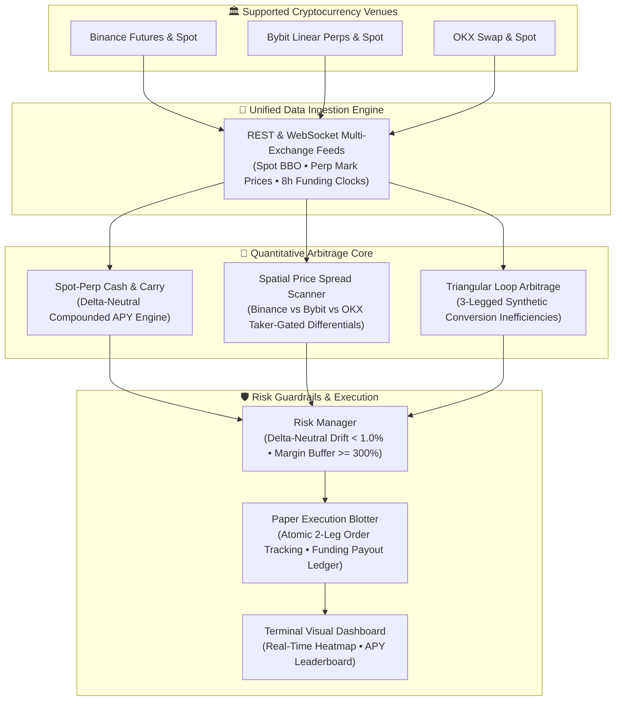

# ⚡ OpenCryptoArbitrage — Cross-Exchange Crypto Arbitrage & Funding Rate Scanner

[](https://python.org)
[](https://github.com/jahanzaib-codes/OpenCryptoArbitrage)
[](https://ccxt.com)
[](https://github.com/jahanzaib-codes/OpenCryptoArbitrage)
[](https://opensource.org/licenses/MIT)

> An institutional-grade, high-frequency cryptocurrency arbitrage and perpetual funding-rate engine connecting **Binance, Bybit, and OKX**. Scans real-time **perpetual basis spreads, cross-exchange funding rate discrepancies, intra-exchange triangular loops**, and computes **Net Compounded APY** after deducting taker fees, slippage, and borrow costs with automated delta-neutral paper execution.

---

### 💼 Need Custom Quantitative Crypto Systems, Arbitrage Bots, or Market Makers?
I engineer low-latency crypto arbitrage infrastructure, perpetual market-making bots, and decentralized trading systems for hedge funds, prop trading syndicates, and private liquidity desks.
* 💬 **Telegram:** [@JanzebBlockdev](https://t.me/JanzebBlockdev)
* 💼 **Fiverr Profile:** [Verified Quantitative Developer (Fiverr)](https://www.fiverr.com/jahanzaib313110)

---

## 🏗️ System Architecture



---

## ⚡ Core Arbitrage Strategies

### 1. 📈 Delta-Neutral Spot-Perp Cash & Carry
* **Mechanism:** Long Spot on Exchange A while simultaneously Shorting Perpetual Futures on Exchange A (or B) with 1x leverage.
* **Payoff:** Collects the 8-hour funding payment 3 times daily (00:00, 08:00, 16:00 UTC) with **zero directional market risk**:
  $$\text{Compounded APY} = \left( (1 + \text{Funding Rate}_{8h})^{1095} - 1 \right) \times 100\%$$
* **Friction Deduction:** Automatically amortizes round-trip taker fees ($0.05\% \times 2 = 0.10\%$) and slippage over a standard 14-day hold.

### 2. 🔀 Cross-Exchange Perpetual Funding Spread
* **Mechanism:** When Bybit funding rate is $+0.06\%$ while Binance is $+0.01\%$, enter a Long Perp on Binance and Short Perp on Bybit. Captures the net $+0.05\%$ funding rate divergence without holding physical spot.

### 3. ⚡ Spatial Price Disparity Arbitrage
* **Mechanism:** Detects instantaneous order book dislocations between venues where:
  $$\text{Bid}_{\text{Exchange B}} - \text{Ask}_{\text{Exchange A}} > \text{Taker Fee}_{\text{Total}} + \text{Slippage}$$
* Yields riskless execution profit on rapid cross-venue liquidity imbalances.

### 4. 🔺 Triangular Currency Loops
* **Mechanism:** Identifies synthetic mispricings across 3 spot pairs within the same venue (e.g., $\text{USDT} \rightarrow \text{BTC} \rightarrow \text{ETH} \rightarrow \text{USDT}$).

---

## 🖥️ Terminal Dashboard Output Preview

```
┏━━━━━━━━━━┳━━━━━━━━━━━━━━┳━━━━━━━━━━━━┳━━━━━━━━━━┳━━━━━━━━━━━━┓
┃ Pair     ┃ Binance Rate ┃ Bybit Rate ┃ OKX Rate ┃ Next Cycle ┃
┡━━━━━━━━━━╇━━━━━━━━━━━━━━╇━━━━━━━━━━━━╇━━━━━━━━━━╇━━━━━━━━━━━━┩
│ BTC/USDT │     +0.0125% │   +0.0118% │ +0.0120% │   142 mins │
│ ETH/USDT │     +0.0180% │   +0.0245% │ +0.0195% │   142 mins │
│ SOL/USDT │     +0.0420% │   +0.0680% │ +0.0450% │   142 mins │
│ DOGE/USDT│     +0.0550% │   +0.0820% │ +0.0510% │   142 mins │
│ PEPE/USDT│     +0.0650% │   +0.1120% │ +0.0720% │   142 mins │
└━━━━━━━━━━┴━━━━━━━━━━━━━━┴━━━━━━━━━━━━┴━━━━━━━━━━┴━━━━━━━━━━━━┘

🔥 Top Delta-Neutral Funding Opportunities (Min Net APY > 15.0%)
┏━━━━━━━━━━┳━━━━━━━━━━━━━━━━━━━━━━━━━━━━┳━━━━━━━━━━━━━━━━━━━━┳━━━━━━━━━━━━━━━━━━━━━┳━━━━━━━━━━┳━━━━━━━━━━━┳━━━━━━━━━━━━━━━━━┓
┃ Pair     ┃ Strategy Type              ┃ Long Leg           ┃ Short Leg           ┃  8h Rate ┃ Gross APY ┃ Net APY (Fees)  ┃
┡━━━━━━━━━━╇━━━━━━━━━━━━━━━━━━━━━━━━━━━━╇━━━━━━━━━━━━━━━━━━━━╇━━━━━━━━━━━━━━━━━━━━━╇━━━━━━━━━━╇━━━━━━━━━━━╇━━━━━━━━━━━━━━━━━┩
│ PEPE/USDT│ CASH AND CARRY             │ BUY SPOT (BYBIT)   │ SHORT PERP (BYBIT)  │ +0.1120% │    238.4% │          225.8% │
│ DOGE/USDT│ CASH AND CARRY             │ BUY SPOT (BYBIT)   │ SHORT PERP (BYBIT)  │ +0.0820% │    145.2% │          133.5% │
│ SOL/USDT │ CROSS EXCHANGE FUNDING     │ LONG PERP (BINANCE)│ SHORT PERP (BYBIT)  │ +0.0260% │     33.2% │           27.4% │
│ ETH/USDT │ CASH AND CARRY             │ BUY SPOT (BYBIT)   │ SHORT PERP (BYBIT)  │ +0.0245% │     30.8% │           24.9% │
└━━━━━━━━━━┴━━━━━━━━━━━━━━━━━━━━━━━━━━━━┴━━━━━━━━━━━━━━━━━━━━┴━━━━━━━━━━━━━━━━━━━━━┴━━━━━━━━━━┴━━━━━━━━━━━┴━━━━━━━━━━━━━━━━━┘
```

---

## 🚀 Quickstart

### 1. Installation

```bash
git clone https://github.com/jahanzaib-codes/OpenCryptoArbitrage.git
cd OpenCryptoArbitrage
python -m venv .venv

# Windows
.venv\Scripts\activate
# Linux / macOS
source .venv/bin/activate

pip install -r requirements.txt
```

### 2. Configure Environment

Copy example environment variables:
```bash
cp .env.example .env
```

Edit `.env` (optional — works out-of-the-box in Simulator mode without API keys):
```ini
DATA_MODE=simulator         # options: simulator, live
MIN_NET_APY_THRESHOLD=15.0  # Min APY (%) to trigger alerts
MIN_SPREAD_PCT=0.25         # Min cross-exchange spread (%)
MAX_POSITION_USD=25000.0    # Position cap per leg
```

### 3. Run Real-Time Scanner

```bash
# Run one-shot cross-exchange scan
python cli.py

# Run continuous 10-second polling daemon
python cli.py --watch --interval 10
```

---

## 🛡️ Risk Management & Delta Neutrality

1. **Delta Neutrality Guardrail:** The system rejects any trade where the notional long and short legs drift by more than $1.0\%$.
2. **Margin Ratio Safeguard:** Enforces a minimum $250\%$ margin ratio on perpetual short legs to protect against sudden short squeezes.
3. **Execution Size Limit:** Caps individual legs at `MAX_POSITION_USD` to stay within exchange top-of-book market depth.

---

## 📄 License

Distributed under the **MIT License**. See `LICENSE` for details.

---

### 🌟 Maintained by **Jahanzaib**
* **GitHub:** [@jahanzaib-codes](https://github.com/jahanzaib-codes)
* **Fiverr:** [Hire for Quant & Trading Bot Development](https://www.fiverr.com/jahanzaib313110)
* **Telegram:** [@JanzebBlockdev](https://t.me/JanzebBlockdev)

